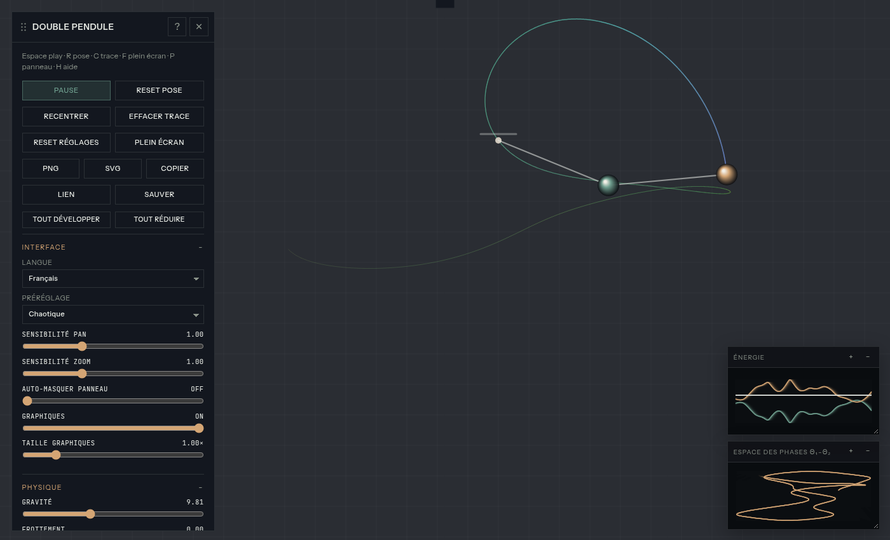

# Double Pendulum · Double Pendule

[English](#english) · [Français](#français)

## ▶️ [Open the simulation · Ouvrir la simulation](https://jdv38.github.io/double-pendule/)

---

## English

Interactive double pendulum simulation in a single HTML file that runs directly in your browser.

### How it works

A double pendulum is a pendulum hanging from the end of another pendulum. Despite its simplicity, it is one of the best-known examples of a **chaotic system**: a tiny difference in the starting angles is enough to produce completely different trajectories after a few seconds.

The equations of motion are integrated numerically with the 4th-order Runge-Kutta method (RK4), and the animation is rendered in real time on a canvas.

### Features

- **Adjustable physics**: gravity, friction, length and mass of each arm, time speed.
- **Presets**: Calm, Chaotic, High friction, Heavy tip, Fast time.
- **Trajectory trail**: gradient, solid color, speed-based color or rainbow, for one mass or both.
- **Energy chart**: potential, kinetic and total energy over time. Without friction the total stays roughly constant; with friction it decreases.
- **Phase space**: plot of θ₂ against θ₁ to tell regular motion from chaos.
- **Export and share**: PNG or SVG image, copy image, share link, save settings.
- Interface in English and French.

### Controls

| Action | Effect |
|---|---|
| Drag a mass | Set the starting angles |
| Drag the background | Pan the view |
| Mouse wheel | Zoom |
| Double-click | Recenter |
| `Space` | Play / pause |
| `R` | Reset the starting pose |
| `C` | Clear the trail |
| `F` | Fullscreen |
| `P` | Show / hide the panel |
| `H` | Help |

### Run locally

No installation needed: download `index.html` and open it in a browser.

---

## Français

Simulation interactive d'un double pendule, en un seul fichier HTML, qui tourne directement dans le navigateur.

### Le principe

Un double pendule, c'est un pendule accroché au bout d'un autre pendule. Malgré sa simplicité, c'est l'un des exemples les plus connus de **système chaotique** : une différence minuscule dans les angles de départ suffit pour obtenir, au bout de quelques secondes, des trajectoires complètement différentes.

Les équations du mouvement sont intégrées numériquement avec la méthode de Runge-Kutta d'ordre 4 (RK4), et l'animation est rendue en temps réel dans un canvas.

### Fonctionnalités

- **Physique réglable** : gravité, frottement, longueurs et masses des deux bras, vitesse du temps.
- **Préréglages** : Calme, Chaotique, Forte friction, Masse lourde, Temps rapide.
- **Trace de la trajectoire** : dégradé, couleur fixe, couleur selon la vitesse ou arc-en-ciel, pour une masse ou les deux.
- **Graphique d'énergie** : énergie potentielle, cinétique et totale au fil du temps. Sans frottement, le total reste à peu près constant ; avec frottement, il diminue.
- **Espace des phases** : tracé de θ₂ en fonction de θ₁ pour distinguer un mouvement régulier du chaos.
- **Export et partage** : image PNG ou SVG, copie de l'image, lien de partage, sauvegarde des réglages.
- Interface en français et en anglais.

### Utilisation

| Action | Effet |
|---|---|
| Glisser une masse | Choisir les angles de départ |
| Glisser le fond | Déplacer la vue |
| Molette | Zoomer |
| Double-clic | Recentrer |
| `Espace` | Lancer / mettre en pause |
| `R` | Remettre la pose de départ |
| `C` | Effacer la trace |
| `F` | Plein écran |
| `P` | Afficher / masquer le panneau |
| `H` | Aide |

### Lancer en local

Aucune installation n'est nécessaire : téléchargez `index.html` et ouvrez-le dans un navigateur.
